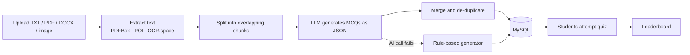

# AI Quiz Generator

A Spring Boot web app that turns study material (TXT, PDF, DOCX or an image) into multiple-choice quizzes using a large language model, with a rule-based fallback when the AI is unavailable. Teachers upload material and generate quizzes; students sign in, take them and get scored instantly; a leaderboard ranks the results.

## Features

- **AI quiz generation:** creates 5, 10 or 20 MCQs from uploaded material. Works with any OpenAI-compatible API; the default is [Groq](https://groq.com) running `openai/gpt-oss-20b` (free tier available).
- **Rule-based fallback:** if the AI call fails (no key, rate limit, network error), a simple text-based generator produces the quiz instead, so generation never hard-fails. Each quiz records which method made it (`AI` or `RULE_BASED`).
- **Multiple file formats:** TXT, PDF and DOCX are read locally (PDFBox, Apache POI). Scanned PDFs and JPG/PNG images are sent to the [OCR.space](https://ocr.space) API.
- **Longer documents:** text over 3,000 characters is split into overlapping chunks, processed in parallel, and the questions are merged and de-duplicated.
- **Resilience:** AI calls are retried (3 attempts by default), run on a background thread pool, and cached, so the same text with the same settings isn't sent twice.
- **Teacher dashboard:** upload and delete material, generate, regenerate and delete quizzes.
- **Student page:** pick a quiz, answer it, see the score immediately, and review past attempts.
- **Leaderboard:** top 50 overall or per quiz.
- **Sign-in:** register and log in as a Student or a Teacher. All pages require sign-in, and the teacher dashboard is for teachers only.

## Tech stack

| Layer | Technology |
|---|---|
| Backend | Java 17, Spring Boot 3.2 (Web, Data JPA, Validation, Cache, Retry) |
| Database | MySQL (tested on 26.10) |
| AI | Groq via the OpenAI-compatible API (`com.theokanning.openai-gpt3-java` client) |
| Document parsing | Apache PDFBox 3, Apache POI 5, OCR.space API |
| Configuration | `.env` file loaded by `spring-dotenv` |
| Frontend | HTML, CSS, vanilla JavaScript |

## How it works



## Prerequisites

- **Java 17 or 21:** from [adoptium.net](https://adoptium.net), or `brew install openjdk@17` (then follow the instructions it prints to add `java` to your PATH).
- **Maven 3.6+**
- **MySQL 8+**
- **A Groq API key** (optional). Get one free at [console.groq.com/keys](https://console.groq.com/keys). Without a key, every quiz uses the rule-based fallback.

On macOS, Maven and MySQL install with Homebrew:

```bash
brew install maven mysql
brew services start mysql
```

## Setup

### 1. Create the database and a user

```bash
mysql -u root
```

```sql
CREATE DATABASE quiz_generator_db;
CREATE USER 'quizgen'@'localhost' IDENTIFIED BY 'choose-a-password';
GRANT ALL PRIVILEGES ON quiz_generator_db.* TO 'quizgen'@'localhost';
```

The tables are created automatically on first start.

### 2. Create a `.env` file

In the project root (next to `pom.xml`), create `.env`:

```properties
GROQ_API_KEY=gsk_your_key_here
DB_USERNAME=quizgen
DB_PASSWORD=choose-a-password
```

- No spaces around `=` and no trailing spaces; they become part of the value.
- `.env` is listed in `.gitignore`. Never commit it.
- The app reads `.env` from the folder it is started in, so always start it from the project root.

### 3. Build and run

```bash
mvn clean package
java -jar target/ai-quiz-generator-1.0.0.jar
```

Or, during development, `mvn spring-boot:run`.

Open **http://localhost:8080**.

On Windows, `start.bat` runs the JAR, but it sets `DB_USERNAME` and `DB_PASSWORD` itself, overriding `.env`. Edit those two lines to match your MySQL user first.

### Quick demo without MySQL

To try the app without installing MySQL, run it on the bundled in-memory H2 database. All data is lost when the app stops.

```bash
java -jar target/ai-quiz-generator-1.0.0.jar \
  --spring.datasource.url='jdbc:h2:mem:quizdb;MODE=MySQL;DB_CLOSE_DELAY=-1' \
  --spring.datasource.username=sa --spring.datasource.password= \
  --spring.datasource.driver-class-name=org.h2.Driver \
  --spring.jpa.properties.hibernate.dialect=org.hibernate.dialect.H2Dialect \
  --spring.jpa.hibernate.ddl-auto=create-drop
```

## Usage

1. Go to **http://localhost:8080** and register as a **Teacher**.
2. On the teacher dashboard, upload a file (try the included `sample-material.txt`), then click **Generate Quiz** and choose 5, 10 or 20 questions.
3. Log out, register as a **Student**, open the student page, pick the quiz, answer it and submit to see your score.
4. Open the **Leaderboard** to see rankings globally or for one quiz.

| Page | URL |
|---|---|
| Home | http://localhost:8080 |
| Sign in / register | http://localhost:8080/login.html |
| Teacher dashboard | http://localhost:8080/teacher.html |
| Student quiz | http://localhost:8080/student.html |
| Leaderboard | http://localhost:8080/leaderboard.html |

## Configuration

Settings live in `src/main/resources/application.properties`. The most useful ones:

| Property | Default | Purpose |
|---|---|---|
| `openai.base.url` | `https://api.groq.com/openai/v1/` | Any OpenAI-compatible endpoint (Groq, OpenRouter, OpenAI) |
| `openai.model` | `openai/gpt-oss-20b` | Model name at that endpoint |
| `openai.max.tokens` | `2000` | Max tokens per AI response |
| `app.quiz.fallback.enabled` | `true` | Use the rule-based generator when AI fails |
| `app.quiz.chunk.max.chars` | `3000` | Chunk size for long documents |
| `app.quiz.ai.max.retries` | `3` | Retries per AI call |
| `spring.servlet.multipart.max-file-size` | `30MB` | Upload size limit |
| `server.port` | `8080` | HTTP port |

The API key and database credentials come from `.env` (see Setup) and are not stored in this file. To use your own OCR.space key, add `ocr.space.api.key=...`.

Rebuild (`mvn clean package`) after changing `application.properties`.

## API endpoints

**Auth**

| Method | Endpoint | Description |
|---|---|---|
| POST | `/api/auth/register` | Register. Body: `username`, `email`, `password`, `fullName`, `role` (`STUDENT` or `TEACHER`) |
| POST | `/api/auth/login` | Log in. Body: `username`, `password` |

**Study materials**

| Method | Endpoint | Description |
|---|---|---|
| POST | `/api/materials/upload` | Upload a file (multipart field `file`) |
| GET | `/api/materials` | List materials |
| GET | `/api/materials/{id}` | Get one material |
| DELETE | `/api/materials/{id}` | Delete a material |

**Quizzes**

| Method | Endpoint | Description |
|---|---|---|
| POST | `/api/quiz/generate/{materialId}` | Generate a quiz. Query: `questionCount` (default 10), `quizTitle` (optional) |
| POST | `/api/quiz/{id}/regenerate` | Replace a quiz's questions. Query: `questionCount` |
| GET | `/api/quiz` | List quizzes (`?activeOnly=true` for active only) |
| GET | `/api/quiz/{id}` | Get a quiz with its questions |
| DELETE | `/api/quiz/{id}` | Delete a quiz |

**Attempts**

| Method | Endpoint | Description |
|---|---|---|
| POST | `/api/quiz/{quizId}/attempt` | Submit answers. Body: `{"studentName": "...", "answers": {"<questionId>": 1-4}}` |
| GET | `/api/quiz/{quizId}/attempts` | Attempts for one quiz |
| GET | `/api/quiz/attempts/student/{studentName}` | Attempts by one student |
| GET | `/api/quiz/attempts/all` | All attempts |

**Leaderboard**

| Method | Endpoint | Description |
|---|---|---|
| GET | `/api/leaderboard` | Top 50 attempts overall |
| GET | `/api/leaderboard/quiz/{quizId}` | Top 50 attempts for one quiz |

Rankings are by score (highest first), with earlier attempts winning ties.

Example:

```bash
curl -F file=@sample-material.txt http://localhost:8080/api/materials/upload
curl -X POST "http://localhost:8080/api/quiz/generate/1?questionCount=5"
```

## Project structure

```text
AI_quiz_generator/
├── src/main/java/com/quizgen/
│   ├── QuizGeneratorApplication.java
│   ├── config/          # Thread pool for background quiz generation
│   ├── controller/      # REST endpoints (auth, materials, quizzes, attempts, leaderboard)
│   ├── dto/             # Request/response objects
│   ├── model/           # JPA entities: User, StudyMaterial, Quiz, Question, QuizAttempt
│   ├── repository/      # Spring Data repositories
│   └── service/
│       ├── AIQuizGenerationService.java         # Chunking, LLM calls, retries, caching
│       ├── RuleBasedQuizGenerationService.java  # Fallback generator
│       ├── QuizGenerationService.java           # Chooses AI or fallback, saves the quiz
│       ├── TextExtractionService.java           # TXT / PDF / DOCX / OCR
│       ├── AuthService.java
│       ├── QuizAttemptService.java
│       └── LeaderboardService.java
├── src/main/resources/
│   ├── application.properties
│   ├── schema.sql
│   └── static/          # index, login, teacher, student, leaderboard pages + css/ and js/
├── sample-material.txt  # Example study material
├── start.bat            # Windows launcher
├── pom.xml
└── .env                 # Your secrets (not committed)
```

## Troubleshooting

**Quizzes have generic options like "A common misconception about this topic".**
The AI call failed and the rule-based fallback was used. Search the console log for `AI generation failed`:
- `Invalid API Key`: check `GROQ_API_KEY` in `.env` (no trailing spaces) and that you started the app from the project root.
- `The model ... does not exist`: Groq has retired that model. Pick a current one from [console.groq.com/docs/models](https://console.groq.com/docs/models), set `openai.model`, and rebuild.

**`Access denied for user` or `Communications link failure` on startup.**
MySQL isn't running (`brew services start mysql`) or `DB_USERNAME`/`DB_PASSWORD` in `.env` don't match the MySQL user.

**`The document is too large (over 3000 words)`.**
Quiz generation accepts up to 3,000 words. Split the document and upload the parts separately.

**Port 8080 is already in use.**
Start with `java -jar target/ai-quiz-generator-1.0.0.jar --server.port=8081`.

## Limitations

- **The API is not protected.** Sign-in and roles are enforced only in the browser; the REST endpoints accept requests from anyone who can reach the server. Passwords are hashed with unsalted SHA-256. For real use, add Spring Security with BCrypt and token-based auth.
- **No automated tests yet.**
- **Documents are limited to 3,000 words** per quiz.
- **OCR depends on an external service** (OCR.space), so scanned PDFs and images need internet access and are subject to its rate limits.
- **Fallback questions are basic.** The rule-based generator picks sentences from the text and uses fixed wrong answers. It keeps the app working, but it is no substitute for AI generation.

## Future improvements

- Spring Security with JWT and BCrypt
- Unit and integration tests
- More question types (true/false, fill in the blanks)
- Timed quizzes and quiz scheduling
- Per-student analytics

## License

This project is for educational purposes.
